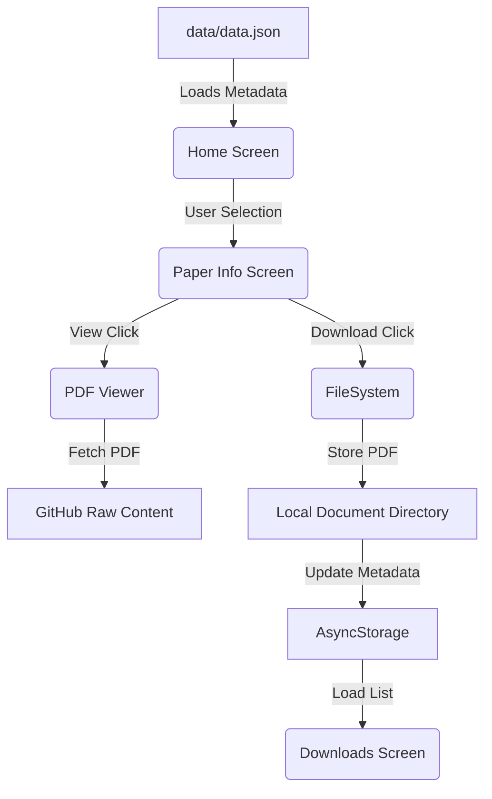

# ත්‍රිපිටක විභාග Past Papers - App Documentation

This document provides a comprehensive overview of the **ත්‍රිපිටක විභාග Past Papers** mobile application, detailing its functionality, architecture, and user interface.

---

## 📖 How the App Works

The app serves as a digital library for students preparing for **Sri Lanka Thripitaka Examinations**. It allows users to browse, view, and download past papers across various examination categories and years.

### Key Workflows:
1.  **Exploration**: Users select an examination type, subject category, and year using an intuitive filtering system.
2.  **Viewing**: Papers can be viewed instantly within the app via a built-in PDF viewer that fetches content directly from GitHub.
3.  **Offline Access**: Users can download papers to their device's local storage for offline study.
4.  **Management**: A dedicated Downloads section allows users to manage their saved papers, share them, or print them.

---

## 📐 Screen Wireframes & UI Structure

The app uses a combination of **Bottom Tab Navigation** (for main features) and **Drawer Navigation** (for auxiliary content).

### 1. Main Navigation (Tabs)
-   **Home Screen (`(tabs)/index`)**: 
    -   Header with a "Home" title and a drawer toggle.
    -   A sequence of dropdown pickers (Exams → Categories → Years/Parts).
    -   A dynamic summary text showing the current selection.
    -   "Next" button to navigate to the Paper Info screen.
-   **Paper Info Screen (`(tabs)/paper`)**:
    -   Displays details of the selected paper (Exam, Category, Title).
    -   "View Paper" (පත්‍රය බලන්න) button to open the PDF viewer.
    -   "Download Paper" (පත්‍රය බාගන්න) button with a progress indicator.
-   **Downloads Screen (`(tabs)/list`)**:
    -   List of all downloaded papers stored on the device.
    -   Actions for each item: View, Delete, Print, and Export to the system downloads folder.

### 2. Auxiliary Screens (Drawer)
-   **About Screen (`(drawer)/about`)**: Information about the app development and purpose.
-   **Services Screen (`(drawer)/services`)**: Details about the developer's services (E-Marketing Paradice).

### 3. PDF Viewer (`pdf_viewer`)
-   A full-screen view that renders the PDF content with page navigation controls (Page X of Y).

---

## 🔄 Data Flow

The app's data management is designed for reliability and performance.



1.  **Source of Truth**: All metadata (exams, categories, subjects, and GitHub links) is stored in `data/data.json`.
2.  **State Management**: Local selection state is managed via React hooks (`useState`, `useMemo`).
3.  **Persistence**:
    -   **AsyncStorage**: Stores a JSON list of downloaded paper metadata (title, category, local URI).
    -   **FileSystem**: Stores the actual `.pdf` files in the app's private document directory.

---

## 📄 How PDFs are Shown

The app implements a seamless PDF viewing experience using the `react-native-pdf` library.

### Technical Implementation:
-   **Component**: `components/custom/PDFViewer.tsx`
-   **Loading Mechanism**:
    1.  The viewer receives a `githubpdfUrl`.
    2.  If the URL points to a remote server (GitHub), it uses `expo-file-system` to download the file into the temporary cache directory.
    3.  Once downloaded (or if the path is already local), the `Pdf` component renders the file.
-   **User Features**:
    -   **Pinch-to-zoom**: Supported natively.
    -   **Page Indicator**: Shows current and total pages.
    -   **Error Handling**: Displays a fallback UI if the network is unavailable or the PDF is corrupted.
-   **Caching**: Remote PDFs are cached during the session to avoid redundant downloads when navigating between screens.

---
*Created by E-Marketing Paradice Design Lab*

## 💻 Source Code Reference

### 1. Application Screens

#### [Root Layout](file:///e:/DO%20NOT%20TOUCH/Apps/app/_layout.tsx)
```tsx
import React from 'react';
import { DarkTheme, DefaultTheme, ThemeProvider } from '@react-navigation/native';
import { useFonts } from 'expo-font';
import { Stack } from 'expo-router';
import { StatusBar } from 'expo-status-bar';
import { SafeAreaProvider, SafeAreaView } from 'react-native-safe-area-context';
import { LinearGradient } from 'expo-linear-gradient';
import { useColorScheme } from '@/hooks/useColorScheme';

export default function RootLayout() {
  const colorScheme = useColorScheme();

  const [loaded] = useFonts({
    SpaceMono: require('../assets/fonts/SpaceMono-Regular.ttf'),
  });

  if (!loaded) {
    return null;
  }

  const isDark = colorScheme === 'dark';

  return (
    <ThemeProvider value={isDark ? DarkTheme : DefaultTheme}>
      <SafeAreaProvider>
        <StatusBar translucent style={isDark ? 'light' : 'dark'}  />

        <LinearGradient
          colors={isDark ? ['#000000', '#121212'] : ['#F7F4EF', '#FFEAC6']}
          style={{ flex: 1 }}
        >
          <SafeAreaView style={{ flex: 1, backgroundColor: 'transparent' }} edges={['top', 'bottom']}>
            <Stack initialRouteName="index" screenOptions={{ headerShown: false }}>
              <Stack.Screen name="(tabs)" />
              <Stack.Screen name="+not-found" />
              <Stack.Screen name="(drawer)" />
            </Stack>
          </SafeAreaView>
        </LinearGradient>
      </SafeAreaProvider>
    </ThemeProvider>
  );
}
```

#### [Home Screen](file:///e:/DO%20NOT%20TOUCH/Apps/app/(tabs)/index.tsx)
```tsx
import { ThemedText } from '@/components/ThemedText';
import { ThemedView } from '@/components/ThemedView';
import { Pressable, StyleSheet, View, ScrollView, Alert, useColorScheme } from 'react-native';
import { LinearGradient } from 'expo-linear-gradient';
import { useState, useMemo } from 'react';
import { Ionicons } from '@expo/vector-icons';
import { useRouter } from 'expo-router';
import { Picker } from '@react-native-picker/picker';
import examsDataRaw from '../../data/data.json';
import CustomButton from '@/components/custom/CustomButton';

type Paper = { part?: number; year: number; paper_title: string; link: string };
type ExamCategory = {
  name: string;
  papers: Paper[];
};
type Exam = { title: string; categories: ExamCategory[] };

const examsData = examsDataRaw as Exam[];

export default function GetStartTab() {
  const router = useRouter();
  const colorScheme = useColorScheme();
  const isDark = colorScheme === 'dark';

  const [searchText, setSearchText] = useState('');
  const [selectedExam, setSelectedExam] = useState(examsData[0]?.title ?? '');
  const [selectedCategory, setSelectedCategory] = useState('');
  const [selectedYear, setSelectedYear] = useState<string>('');
  const [selectedPart, setSelectedPart] = useState<string>('');

  const filteredExams = useMemo(() => {
    if (!searchText.trim()) return examsData;
    return examsData.filter((exam) =>
      exam.title.toLowerCase().includes(searchText.toLowerCase())
    );
  }, [searchText]);

  const selectedExamObj = examsData.find((e) => e.title === selectedExam);
  const categories = selectedExamObj?.categories ?? [];
  const selectedCategoryObj = categories.find((c) => c.name === selectedCategory);
  const papers = selectedCategoryObj?.papers ?? [];

  const uniqueYearPapers = useMemo(() => {
    const map = new Map<number, Paper>();
    papers.forEach((p) => {
      if (!map.has(p.year)) {
        map.set(p.year, p);
      }
    });
    return Array.from(map.values());
  }, [papers]);

  const selectedYearPapers = useMemo(() => {
    if (!selectedYear) return [];
    const year = parseInt(selectedYear);

    return papers.filter((p) => p.year === year);
  }, [selectedYear, papers]);

  const selectedPaper =
    selectedYearPapers.length > 0 ? selectedYearPapers[0] : undefined;

  const availableParts =
    selectedYearPapers.length > 0 && 'part' in selectedYearPapers[0]
      ? (selectedYearPapers as Paper[]).filter((p) => p.part)
      : [];

  return (
    <LinearGradient
      colors={
        isDark ? ['#000000', '#000000'] : ['#F7F4EF', '#ffeac6ff']
      }
      style={{ flex: 1 }}
    >
      <ScrollView
        contentContainerStyle={{ flexGrow: 1 }}
        keyboardShouldPersistTaps="handled"
        showsVerticalScrollIndicator={false}
      >
        <ThemedView style={styles.headerContainer}>
          <Pressable
            onPress={() => router.push('/(drawer)')}
            style={[
              styles.backButton,
              isDark && { backgroundColor: 'rgba(255,255,255,0.08)' },
            ]}
          >
            <Ionicons
              name="arrow-back"
              size={28}
              color={isDark ? '#fff' : '#2E2E2E'}
            />
          </Pressable>
        </ThemedView>

        <Ionicons
          name="leaf"
          size={100}
          color={isDark ? 'rgba(255,255,255,0.05)' : 'rgba(255, 166, 1, 0.1)'}
          style={styles.leafIcon}
        />

        <ThemedView style={styles.container}>
          <ThemedText style={[styles.title, { color: isDark ? '#f9fafb' : '#1F2937' }]}>
            ශ්‍රී ලංකා ත්‍රිපිටක විභාගයට අදාළ පසුගිය ප්‍රශ්න පත්‍ර
          </ThemedText>

          <ThemedView style={styles.section}>
            <ThemedText style={[styles.sectionTitle, { color: isDark ? '#e5e7eb' : '#374151' }]}>
              ඔබගේ විභාගය තෝරන්න
            </ThemedText>

            <View style={[styles.dropdownWrapper, isDark && { backgroundColor: '#111', borderColor: '#333' }]}>
              <Picker
                selectedValue={selectedExam}
                onValueChange={(itemValue) => {
                  setSelectedExam(itemValue);
                  setSelectedCategory('');
                  setSelectedYear('');
                  setSelectedPart('');
                }}
                style={[styles.dropdown, { color: isDark ? '#f3f4f6' : '#1F2937' }]}
              >
                {filteredExams.map((exam, idx) => (
                  <Picker.Item key={idx} label={exam.title} value={exam.title} />
                ))}
              </Picker>
            </View>

            <View style={[styles.dropdownWrapper, isDark && { backgroundColor: '#111', borderColor: '#333' }]}>
              <Picker
                selectedValue={selectedCategory}
                onValueChange={(itemValue) => {
                  setSelectedCategory(itemValue);
                  setSelectedYear('');
                  setSelectedPart('');
                }}
                style={[styles.dropdown, { color: isDark ? '#f3f4f6' : '#1F2937' }]}
              >
                <Picker.Item label="කාණ්ඩය තෝරන්න..." value="" />
                {categories.map((cat, idx) => (
                  <Picker.Item key={idx} label={cat.name} value={cat.name} />
                ))}
              </Picker>
            </View>

            <View style={[styles.dropdownWrapper, isDark && { backgroundColor: '#111', borderColor: '#333' }]}>
              <Picker
                selectedValue={selectedYear}
                onValueChange={(itemValue) => {
                  setSelectedYear(itemValue);
                  setSelectedPart('');
                }}
                style={[styles.dropdown, { color: isDark ? '#f3f4f6' : '#1F2937' }]}
              >
                <Picker.Item label="වර්ෂය තෝරන්න..." value="" />
                {uniqueYearPapers.map((paper, idx) => (
                  <Picker.Item
                    key={idx}
                    label={`${paper.paper_title} (${paper.year})`}
                    value={paper.year.toString()}
                  />
                ))}
              </Picker>
            </View>

            {availableParts.length > 0 && (
              <View style={[styles.dropdownWrapper, isDark && { backgroundColor: '#111', borderColor: '#333' }]}>
                <Picker
                  selectedValue={selectedPart}
                  onValueChange={setSelectedPart}
                  style={[styles.dropdown, { color: isDark ? '#f3f4f6' : '#1F2937' }]}
                >
                  <Picker.Item label="පත්‍රය තෝරන්න..." value="" />
                  {availableParts.map((p, idx) => (
                    <Picker.Item
                      key={idx}
                      label={`Part ${p.part}`}
                      value={p.part?.toString()}
                    />
                  ))}
                </Picker>
              </View>
            )}

            <ThemedText style={[styles.selectedInfo, { color: isDark ? '#d1d5db' : '#4B5563' }]}>
              {selectedExam && selectedCategory && selectedPaper || selectedPart
                ? `ඔබ තෝරාගත්තේ: ${selectedExam} → ${selectedCategory} → ${selectedPaper.year} - ${selectedPaper.paper_title}${selectedPart ? ` (Part ${selectedPart})` : ''}`
                : 'කරුණාකර සියල්ල තෝරන්න'}
            </ThemedText>

            <CustomButton
              title="Next"
              style={{ marginTop: 40, marginBottom: 80 }}
              pressedStyle={{ backgroundColor: isDark ? '#333' : '#000' }}
              onPress={() => {
                if (selectedExam && selectedCategory && selectedPaper) {
                  let linkToSend = selectedPaper.link;

                  if (selectedPart && 'part' in selectedPaper) {
                    const matchingPart = (selectedYearPapers as Paper[]).find(
                      (p) => p.part?.toString() === selectedPart
                    );
                    if (matchingPart) {
                      linkToSend = matchingPart.link;
                    }
                  }

                  router.push({
                    pathname: '/paper',
                    params: {
                      exam: selectedExam,
                      category: selectedCategory,
                      paperTitle: selectedPaper.paper_title,
                      paperLink: linkToSend,
                      part: selectedPart,
                      year: selectedYear,
                    },
                  });
                } else {
                  Alert.alert(
                    'සැලකිය යුතුයි',
                    'කරුණාකර විභාගය, කාණ්ඩය, වර්ෂය සහ පත්‍රය තෝරන්න.'
                  );
                }
              }}
            />
          </ThemedView>
        </ThemedView>
      </ScrollView>
    </LinearGradient>
  );
}
```

#### [Paper Info Screen](file:///e:/DO%20NOT%20TOUCH/Apps/app/(tabs)/paper.tsx)
```tsx
import { ThemedText } from '@/components/ThemedText';
import { ThemedView } from '@/components/ThemedView';
import {
  StyleSheet,
  View,
  TouchableOpacity,
  ImageBackground,
  Platform,
  ScrollView,
  useColorScheme,
  ActivityIndicator,
  Alert,
} from 'react-native';
import { LinearGradient } from 'expo-linear-gradient';
import { useLocalSearchParams, useRouter } from 'expo-router';
import CustomButton from '@/components/custom/CustomButton';
import * as FileSystem from 'expo-file-system';
import { Ionicons } from '@expo/vector-icons';
import { BlurView } from 'expo-blur';
import AsyncStorage from "@react-native-async-storage/async-storage";
import { useState } from 'react';
import ErrorPage from '@/components/ErrorPage';

export default function PapersTab() {
  const router = useRouter();
  const colorScheme = useColorScheme();
  const isDark = colorScheme === 'dark';

  const [downloading, setDownloading] = useState(false);
  const [progress, setProgress] = useState(0);
  const [downloadError, setDownloadError] = useState<string | null>(null);

  const { exam, category, paperTitle, paperLink, part, year } =
    useLocalSearchParams<{
      exam: string;
      category: string;
      paperTitle: string;
      paperLink: string;
      part?: string;
      year?: string;
    }>();

  const handleDownload = async () => {
    try {
      setDownloading(true);
      setProgress(0);
      setDownloadError(null);

      const safe = (val?: string) => val ? val.replace(/\s+/g, "_") : "";

      const baseName = [
        safe(paperTitle),
        safe(category),
        safe(year),
        safe(part),
      ].filter(Boolean).join("_");

      const uniqueSuffix = Date.now();
      const fileName = `${baseName}_${uniqueSuffix}.pdf`;
      const downloadUri = FileSystem.documentDirectory + fileName;

      const downloadResumable = FileSystem.createDownloadResumable(
        paperLink,
        downloadUri,
        {},
        (downloadProgress) => {
          const pct =
            downloadProgress.totalBytesWritten /
            downloadProgress.totalBytesExpectedToWrite;
          setProgress(pct);
        }
      );

      const result = await downloadResumable.downloadAsync();
      if (!result || result.status !== 200) {
        throw new Error("Download failed with status " + result?.status);
      }

      const newEntry = {
        title: paperTitle,
        category,
        exam,
        uri: result.uri,
        part,
        year,
        date: new Date().toISOString(),
      };

      let existing = await AsyncStorage.getItem("downloads");
      let downloads = existing ? JSON.parse(existing) : [];
      downloads.push(newEntry);
      await AsyncStorage.setItem("downloads", JSON.stringify(downloads));

      Alert.alert("සාර්ථකයි!", "ගොනුව සාර්ථකව බාගත කරන ලදී!", [
        { text: "හරි", style: "default" },
      ]);
    } catch (err: any) {
      console.error("❌ Error downloading file:", err);
      const errorMessage = err.message?.includes('Network')
        ? "අන්තර්ජාල සම්බන්ධතාවය පරීක්ෂා කර නැවත උත්සාහ කරන්න."
        : "ගොනුව බාගත කිරීමට අසමත් විය. කරුණාකර නැවත උත්සාහ කරන්න.";

      setDownloadError(errorMessage);
      Alert.alert("දෝෂයක්", errorMessage, [
        { text: "හරි", style: "cancel" },
      ]);
    } finally {
      setDownloading(false);
      setProgress(0);
    }
  };

  if (!exam || !category || !paperTitle) {
      return (
        <LinearGradient
          colors={isDark ? ['#000000', '#0a0a0a'] : ['#F7F4EF', '#ffeac6ff']}
          style={styles.gradient}
        >
          <ErrorPage
            isDark={isDark}
            errorType="notFound"
            title="ප්‍රශ්න පත්‍රය තෝරා නොමැත"
            message="කරුණාකර ප්‍රශ්න පත්‍ර ලැයිස්තුවෙන් එකක් තෝරන්න."
            onGoBack={() => router.back()}
          />
        </LinearGradient>
      );
    }

  return (
    <LinearGradient
      colors={
        isDark ? ['#000000', '#0a0a0a'] : ['#F7F4EF', '#ffeac6ff']
      }
      style={styles.gradient}
    >
      <ScrollView contentContainerStyle={{ paddingBottom: 40, backgroundColor: 'transparent' }}>
        <ThemedView style={styles.container}>

          <View style={styles.header}>
            <TouchableOpacity style={styles.backBtn} onPress={() => router.back()}>
              <Ionicons name="arrow-back" size={24} color={isDark ? "#fff" : "#000"} />
            </TouchableOpacity>
            <ThemedText style={styles.headerTitle}>
              ප්‍රශ්න පත්‍ර තොරතුරු
            </ThemedText>
            <View style={{ width: 24 }} />
          </View>

          <View style={styles.imageWrapper}>
            <ImageBackground
              source={require("@/assets/background_app.jpeg")}
              style={styles.imageHeader}
              imageStyle={styles.imageRounded}
            >
              <BlurView
                intensity={isDark ? 50 : 0}
                tint={isDark ? "dark" : "light"}
                style={styles.overlay}
              >
                <ThemedText style={styles.PaperName}>{paperTitle}</ThemedText>
                <ThemedText style={styles.PdfCategory}>{category}</ThemedText>
                <View style={styles.priceBadge}>
                  <ThemedText style={styles.PdfPrice}>Free</ThemedText>
                </View>
              </BlurView>
            </ImageBackground>
          </View>

          <ThemedView style={styles.card}>
            <ThemedView style={styles.row}>
              <Ionicons name="school-outline" size={22} color={isDark ? "#ddd" : "#333"} />
              <ThemedText style={styles.info}>Exam: {exam}</ThemedText>
            </ThemedView>

            <ThemedView style={styles.separator} />

            <ThemedView style={styles.row}>
              <Ionicons name="layers-outline" size={22} color={isDark ? "#ddd" : "#333"} />
              <ThemedText style={styles.info}>Category: {category}</ThemedText>
            </ThemedView>

            <ThemedView style={styles.separator} />

            <ThemedView style={styles.row}>
              <Ionicons name="document-text-outline" size={22} color={isDark ? "#ddd" : "#333"} />
              <ThemedText style={styles.info}>Paper: {paperTitle}</ThemedText>
            </ThemedView>
          </ThemedView>

          <CustomButton
            title="පත්‍රය බලන්න"
            icon={<Ionicons name="eye" size={20} color="#fff" style={{ marginRight: 8 }} />}
            style={[styles.button, styles.viewButton]}
            onPress={() => {
              const encodedLink = encodeURIComponent(paperLink);
              const encodedTitle = encodeURIComponent(paperTitle);
              const encodedYear = encodeURIComponent(year || "");
              const encodedPart = encodeURIComponent(part || "");

              router.push(
                `/pdf_viewer?paperLink=${encodedLink}&paperTitle=${encodedTitle}&year=${encodedYear}&part=${encodedPart}`
              );
            }}
            pressedStyle={{ backgroundColor: isDark ? '#444' : '#333' }}
          />

          <CustomButton
            title={
              downloading
                ? progress > 0
                  ? `බාගැනේ (${Math.round(progress * 100)}%)`
                  : "බාගැනේ..."
                : "පත්‍රය බාගන්න"
            }
            icon={
              downloading ? (
                <ActivityIndicator size="small" color="#fff" style={{ marginRight: 12 }} />
              ) : (
                <Ionicons
                  name="download"
                  size={20}
                  color="#fff"
                  style={{ marginRight: 12 }}
                />
              )
            }
            style={[
              styles.button,
              styles.downloadButton,
              { backgroundColor: isDark ? "#333333" : "#000000" },
              downloading ? { opacity: 0.7 } : {},
            ]}
            onPress={handleDownload}
            disabled={downloading}
            pressedStyle={{
              backgroundColor: isDark ? "#444444" : "#222222",
              opacity: 0.9
            }}
          />
        </ThemedView>
      </ScrollView>
    </LinearGradient>
  );
}
```

#### [Downloads Screen](file:///e:/DO%20NOT%20TOUCH/Apps/app/(tabs)/list.tsx)
```tsx
import React, { useState, useCallback, useMemo } from "react";
import {
  View,
  Text,
  FlatList,
  TouchableOpacity,
  StyleSheet,
  Pressable,
  Alert,
  useColorScheme,
  Platform,
} from "react-native";
import AsyncStorage from "@react-native-async-storage/async-storage";
import { Ionicons } from "@expo/vector-icons";
import { useRouter, useFocusEffect } from "expo-router";
import * as FileSystem from "expo-file-system";
import * as Print from "expo-print";
import * as Sharing from "expo-sharing";
import { ThemedText } from "@/components/ThemedText";
import { LinearGradient } from "expo-linear-gradient";
import { ThemedView } from "@/components/ThemedView";
import ErrorPage from "@/components/ErrorPage";

interface DownloadItem {
  title: string;
  exam: string;
  year?: string;
  part?: string;
  category: string;
  uri: string;
  date?: string;
}

export default function DownloadsTab() {
  const [downloads, setDownloads] = useState<DownloadItem[]>([]);
  const [error, setError] = useState<string | null>(null);
  const [isLoading, setIsLoading] = useState(true);
  const router = useRouter();
  const colorScheme = useColorScheme();
  const isDark = colorScheme === "dark";

  const loadDownloads = async () => {
    try {
      setIsLoading(true);
      setError(null);
      const existing = await AsyncStorage.getItem("downloads");
      if (!existing) {
        setDownloads([]);
        setIsLoading(false);
        return;
      }
      const parsed = JSON.parse(existing);
      if (Array.isArray(parsed)) setDownloads(parsed);
      else setDownloads([]);
      setIsLoading(false);
    } catch (err) {
      console.error("Failed to load downloads:", err);
      setError("බාගත කළ ලැයිස්තුව පූරණය කිරීමට අසමත් විය");
      setDownloads([]);
      setIsLoading(false);
    }
  };

  useFocusEffect(
    useCallback(() => {
      loadDownloads();
    }, [])
  );

  const deletePdf = async (item: DownloadItem) => {
    Alert.alert(
      "Delete PDF",
      `Are you sure you want to delete "${item.title}"?`,
      [
        { text: "Cancel", style: "cancel" },
        {
          text: "Delete",
          style: "destructive",
          onPress: async () => {
            try {
              const stored = await AsyncStorage.getItem("downloads");
              const parsed: DownloadItem[] = stored ? JSON.parse(stored) : [];
              const updated = parsed.filter(
                (d) =>
                  !(
                    d.uri === item.uri &&
                    d.title === item.title &&
                    d.year === item.year &&
                    d.part === item.part
                  )
              );

              const info = await FileSystem.getInfoAsync(item.uri);
              if (info.exists) {
                await FileSystem.deleteAsync(item.uri, { idempotent: true });
              }

              await AsyncStorage.setItem("downloads", JSON.stringify(updated));
              setDownloads(updated);
              Alert.alert("Deleted", `🗑️ "${item.title}" removed successfully.`);
            } catch (err) {
              console.error("❌ Failed to delete:", err);
              Alert.alert("Error", "Failed to delete the file. Please try again.");
            }
          },
        },
      ]
    );
  };

  const printPdf = async (item: DownloadItem) => {
    try {
      await Print.printAsync({ uri: item.uri });
    } catch (err) {
      console.error("❌ Failed to print PDF:", err);
      Alert.alert("Print Error", "Unable to print the file. Please try again.");
    }
  };

  const exportToDownloads = async (item: DownloadItem) => {
    try {
      if (Platform.OS === "android") {
        const permissions = await FileSystem.StorageAccessFramework.requestDirectoryPermissionsAsync();
        if (!permissions.granted) {
          Alert.alert("Permission Denied", "Please allow access to save the file.");
          return;
        }

        const fileContent = await FileSystem.readAsStringAsync(item.uri, {
          encoding: FileSystem.EncodingType.Base64,
        });

        const newUri = await FileSystem.StorageAccessFramework.createFileAsync(
          permissions.directoryUri,
          `${item.category}_${item.title}_${item.year}_${item.part}.pdf`,
          "application/pdf"
        );

        await FileSystem.writeAsStringAsync(newUri, fileContent, {
          encoding: FileSystem.EncodingType.Base64,
        });

        Alert.alert("✅ Saved", "File saved successfully to Downloads folder.");
      } else {
        if (await Sharing.isAvailableAsync()) {
          await Sharing.shareAsync(item.uri);
        } else {
          Alert.alert("Unsupported", "Sharing is not available on this device.");
        }
      }
    } catch (err) {
      console.error("❌ Export failed:", err);
      Alert.alert("Error", "Failed to save file to Downloads. Please try again.");
    }
  };

  const openPdf = (item: DownloadItem) => {
    const encodedLink = encodeURIComponent(item.uri);
    const encodedTitle = encodeURIComponent(item.title);
    const encodedYear = encodeURIComponent(item.year || "");
    const encodedPart = encodeURIComponent(item.part || "");
    router.push(`/pdf_viewer?paperLink=${encodedLink}&paperTitle=${encodedTitle}&year=${encodedYear}&part=${encodedPart}`);
  };

  const renderItem = useCallback(
    ({ item }: { item: DownloadItem }) => (
      <View
        style={[
          styles.item,
          {
            backgroundColor: isDark ? "#000000" : "#fff",
            borderColor: isDark ? "#222" : "#eee",
          },
        ]}
      >
        <TouchableOpacity
          style={{ flex: 1, flexDirection: "row", alignItems: "center" }}
          activeOpacity={0.7}
          onPress={() => openPdf(item)}
        >
          <Ionicons
            name="document-text-outline"
            size={28}
            color={isDark ? "#FFD479" : "#FF9500"}
            style={{ marginRight: 12 }}
          />
          <View style={{ flex: 1 }}>
            <Text style={[styles.title, { color: isDark ? "#fff" : "#222" }]} numberOfLines={1}>
              {item.title} {item.year ? `${item.year}` : ""}
              {item.part ? ` • Part ${item.part}` : ""}
            </Text>
            <Text style={[styles.meta, { color: isDark ? "#999" : "#777" }]} numberOfLines={2}>
              {item.exam}
            </Text>
            <Text style={[styles.meta, { color: isDark ? "#c6c6c6ff" : "#535353ff" }]} numberOfLines={1}>
              කාණ්ඩය - {item.category}
            </Text>
          </View>
        </TouchableOpacity>

        <View style={{ flexDirection: "row", alignItems: "center" }}>
          <Pressable
            onPress={() => exportToDownloads(item)}
            style={[styles.actionButton, { backgroundColor: "#34C759" }]}
          >
            <Ionicons name="download-outline" size={22} color="#fff" />
          </Pressable>

          <Pressable
            onPress={() => printPdf(item)}
            style={[styles.actionButton, { backgroundColor: "#007AFF" }]}
          >
            <Ionicons name="print-outline" size={22} color="#fff" />
          </Pressable>

          <Pressable
            onPress={() => deletePdf(item)}
            style={[styles.actionButton, { backgroundColor: "#FF3B30" }]}
          >
            <Ionicons name="trash-outline" size={22} color="#fff" />
          </Pressable>
        </View>
      </View>
    ),
    [isDark]
  );

  return (
      <LinearGradient colors={isDark ? ["#000", "#000"] : ["#F7F4EF", "#ffeac6ff"]} style={{ flex: 1 }}>
        <View style={styles.container}>
          {downloads.length > 0 && (
            <View style={styles.header}>
              <TouchableOpacity style={styles.backBtn} onPress={() => router.back()}>
                <Ionicons name="arrow-back" size={24} color={isDark ? "#fff" : "#000"} />
              </TouchableOpacity>
              <ThemedText style={styles.headerTitle}>බාගත කළ ප්‍රශ්න පත්‍ර</ThemedText>
              <View style={{ width: 24 }} />
            </View>
          )}

          {downloads.length === 0 ? (
            <View style={styles.emptyContainer}>
              <Ionicons name="folder-open" size={60} color="#fac400ff" />
              <ThemedText style={[styles.emptyText, { color: isDark ? "#fff" : "#000" }]}>📁 ප්‍රශ්න පත්‍ර බාගත කර නොමැත.</ThemedText>
              <ThemedText style={[styles.emptySubText, { color: isDark ? "#888" : "#696969" }]}>කරුණාකර ප්‍රශ්න බාගත කරගන්න.</ThemedText>
            </View>
          ) : (
            <FlatList
              data={downloads}
              renderItem={renderItem}
              keyExtractor={(item, index) => (item.uri ? item.uri : index.toString())}
              contentContainerStyle={{ paddingBottom: 80 }}
              showsVerticalScrollIndicator={false}
            />
          )}
        </View>
      </LinearGradient>
    );
}
```

#### [PDF Viewer Screen](file:///e:/DO%20NOT%20TOUCH/Apps/app/pdf_viewer.tsx)
```tsx
import { LinearGradient } from "expo-linear-gradient";
import PDFViewerFromAsset from "@/components/custom/PDFViewer";
import { useLocalSearchParams } from "expo-router";

export default function PDFViewerScreen() {
  const params = useLocalSearchParams();

  const paperLink = params.paperLink
    ? decodeURIComponent(params.paperLink as string)
    : undefined;

  const paperTitle = params.paperTitle
    ? decodeURIComponent(params.paperTitle as string)
    : undefined;

  const part = params.part as string | undefined;
  const year = params.year as string | undefined;

  const fullTitle = paperTitle
    ? part
      ? `${paperTitle} - Part ${part}`
      : paperTitle
    : "PDF Viewer";

  return (
    <LinearGradient colors={["#F7F4EF", "#ffeac6ff"]} style={{ flex: 1 }}>
      <PDFViewerFromAsset githubpdfUrl={paperLink || ""} title={fullTitle}  year={year}/>
    </LinearGradient>
  );
}
```

#### [About Screen](file:///e:/DO%20NOT%20TOUCH/Apps/app/(drawer)/about.tsx)
```tsx
import { ThemedText } from "@/components/ThemedText";
import { ThemedView } from "@/components/ThemedView";
import { Pressable, StyleSheet, Image, useColorScheme, ScrollView, View, Linking } from "react-native";
import { Ionicons } from "@expo/vector-icons";
import { LinearGradient } from "expo-linear-gradient";
import { useNavigation, DrawerActions } from '@react-navigation/native';
import { BlurView } from "expo-blur";

export default function AboutScreen() {
  const navigation = useNavigation();
  const colorScheme = useColorScheme();
  const isDark = colorScheme === 'dark';

  const handleLink = (url: string) => {
    Linking.openURL(url).catch((err) => console.error("An error occurred", err));
  };

  return (
    <LinearGradient
      colors={isDark ? ['#000000', '#1a1a1a'] : ['#F7F4EF', '#ffeac6ff']}
      style={{ flex: 1 }}
    >
      <ThemedView style={styles.header}>
        <Pressable
          onPress={() => navigation.dispatch(DrawerActions.toggleDrawer())}
          style={[styles.iconButton, { backgroundColor: isDark ? 'rgba(255,255,255,0.1)' : 'rgba(255, 255, 255, 0.8)' }]}
        >
          <Ionicons name="menu" size={26} color={isDark ? '#f3f4f6' : "#2E2E2E"} />
        </Pressable>

        <ThemedText style={[styles.headerTitle, { color: isDark ? '#f3f4f6' : '#000' }]}>
          මෙම යෙදුම පිළිබඳව
        </ThemedText>

        <View style={{ width: 44 }} />
      </ThemedView>

      <ScrollView contentContainerStyle={styles.scrollContent} showsVerticalScrollIndicator={false}>
        <ThemedView style={styles.heroSection}>
          <View style={styles.logoWrapper}>
            <Image
              source={require("@/assets/Our_Logo.png")}
              style={styles.heroLogo}
              resizeMode="contain"
            />
          </View>
          <ThemedText style={[styles.heroTitle, { color: isDark ? "#fff" : "#222" }]}>
            E - Marketing Paradice
          </ThemedText>
          <ThemedText style={[styles.heroSubtitle, { color: isDark ? "#facc15" : "#d97706" }]}>
            Design Lab
          </ThemedText>
        </ThemedView>

        <BlurView
          intensity={isDark ? 40 : 80}
          tint={isDark ? "dark" : "light"}
          style={styles.card}
        >
          <View style={styles.cardHeader}>
            <Ionicons name="information-circle" size={24} color={isDark ? "#facc15" : "#eab308"} />
            <ThemedText style={[styles.cardHeaderText, { color: isDark ? "#fff" : "#111" }]}>App Details</ThemedText>
          </View>
          <ThemedText style={[styles.cardText, { color: isDark ? "#d1d5db" : "#4b5563" }]}>
            මෙම යෙදුම ශ්‍රී ලංකා රාමඤ්ඤය මහා නිකාය මඟින් පවත්වන ශ්‍රී ලංකා ත්‍රිපිටක විභාගයට පෙනී සිටින සියලු දෙනාට අවශ්‍ය පසුගිය ප්‍රශ්න පත්‍ර ලබා දීම සිදු කරයි.
          </ThemedText>
        </BlurView>

        <BlurView
          intensity={isDark ? 40 : 80}
          tint={isDark ? "dark" : "light"}
          style={styles.card}
        >
          <View style={styles.cardHeader}>
            <Ionicons name="code-working" size={24} color={isDark ? "#3b82f6" : "#2563eb"} />
            <ThemedText style={[styles.cardHeaderText, { color: isDark ? "#fff" : "#111" }]}>Developer Profile</ThemedText>
          </View>
          <ThemedText style={[styles.cardText, { color: isDark ? "#d1d5db" : "#4b5563" }]}>
            Developed with ❤️ by E-Marketing Paradice Design Lab. We specialize in building modern, user-friendly digital experiences for the Sri Lankan community.
          </ThemedText>

          <View style={styles.socialRow}>
            <Pressable style={styles.socialButton} onPress={() => handleLink('mailto:emarketingparadice@gmail.com')}>
              <Ionicons name="mail" size={20} color={isDark ? "#fff" : "#333"} />
              <ThemedText style={styles.socialLabel}>Email</ThemedText>
            </Pressable>
            <Pressable style={styles.socialButton} onPress={() => handleLink('https://emarketingparadice.lk')}>
              <Ionicons name="globe" size={20} color={isDark ? "#fff" : "#333"} />
              <ThemedText style={styles.socialLabel}>Web</ThemedText>
            </Pressable>
          </View>
        </BlurView>

        <ThemedView style={styles.footer}>
          <ThemedText style={[styles.version, { color: isDark ? "#9CA3AF" : "#666" }]}>
            Version 1.0.1
          </ThemedText>
          <ThemedText style={[styles.copyright, { color: isDark ? "#6B7280" : "#AAA" }]}>
            © {new Date().getFullYear()} E-Marketing Paradice Design Lab
          </ThemedText>
          <View style={styles.dot} />
        </ThemedView>
      </ScrollView>
    </LinearGradient>
  );
}
```

#### [Services Screen](file:///e:/DO%20NOT%20TOUCH/Apps/app/(drawer)/services.tsx)
```tsx
import { ThemedView } from '@/components/ThemedView';
import { ThemedText } from '@/components/ThemedText';
import {
  StyleSheet,
  Pressable,
  ScrollView,
  View,
  useColorScheme,
} from 'react-native';
import { Ionicons } from '@expo/vector-icons';
import { LinearGradient } from 'expo-linear-gradient';
import { useNavigation, DrawerActions } from '@react-navigation/native';

const sevaawa = [
  { name: 'සමාජ මාධ්‍ය කළමනාකරණය', icon: 'share-social', color: '#3b82f6' },
  { name: 'වෙබ් සංවර්ධනය', icon: 'globe', color: '#10b981' },
  { name: 'ජංගම යෙදුම් සංවර්ධනය', icon: 'phone-portrait', color: '#8b5cf6' },
  { name: 'ග්‍රැෆික් සැලසුම් කිරීම', icon: 'color-palette', color: '#f59e0b' },
  { name: 'ඩිජිටල් වෙළඳපොළ', icon: 'trending-up', color: '#ef4444' },
  { name: 'ලේඛන සැකසුම්', icon: 'document-text', color: '#06b6d4' },
  { name: 'සියළුම පරිගණක සම්බන්ධිත වැඩ', icon: 'desktop', color: '#ec4899' },
];

export default function SevaawaScreen() {
  const navigation = useNavigation();
  const colorScheme = useColorScheme();
  const isDark = colorScheme === 'dark';

  return (
    <LinearGradient
      colors={isDark ? ['#000000', '#0a0a0a'] : ['#F7F4EF', '#FFEAC6']}
      style={{ flex: 1 }}
    >
      <ThemedView style={styles.menuBar}>
        <Pressable
          onPress={() => navigation.dispatch(DrawerActions.toggleDrawer())}
          style={[
            styles.menuButton,
            { backgroundColor: isDark ? 'rgba(255,255,255,0.1)' : 'rgba(255,255,255,0.6)' },
          ]}
        >
          <Ionicons name="menu" size={28} color={isDark ? '#f3f4f6' : '#2E2E2E'} />
        </Pressable>
      </ThemedView>

      <ScrollView contentContainerStyle={styles.container}>
        <ThemedText type="title" style={[styles.title, { color: isDark ? '#f9fafb' : '#2E2E2E' }]}>
          අපගේ සේවාවන්
        </ThemedText>

        <View style={styles.servicesContainer}>
          {sevaawa.map((seva, index) => (
            <View key={index} style={[styles.serviceCard, { backgroundColor: isDark ? '#1a1a1a' : '#FFF' }]}>
              <View style={[styles.iconContainer, { backgroundColor: `${seva.color}20` }]}>
                <Ionicons name={seva.icon as any} size={28} color={seva.color} />
              </View>
              <ThemedText style={[styles.serviceText, { color: isDark ? '#f3f4f6' : '#2E2E2E' }]}>
                {seva.name}
              </ThemedText>
            </View>
          ))}
        </View>
      </ScrollView>
    </LinearGradient>
  );
}
```

### 2. Core Components

#### [PDF Viewer Component](file:///e:/DO%20NOT%20TOUCH/Apps/components/custom/PDFViewer.tsx)
```tsx
import React, { useEffect, useState } from "react";
import {
  View,
  Text,
  StyleSheet,
  ActivityIndicator,
  Pressable,
  Dimensions,
  useColorScheme,
} from "react-native";
import { Ionicons } from "@expo/vector-icons";
import { useRouter } from "expo-router";
import * as FileSystem from "expo-file-system";
import Pdf from "react-native-pdf";

interface PDFViewerProps {
  githubpdfUrl: string;
  title?: string;
  year?: string;
  part?: string;
}

export default function PDFViewerFromAsset({ githubpdfUrl, title, year, part }: PDFViewerProps) {
  const router = useRouter();
  const colorScheme = useColorScheme();
  const isDark = colorScheme === "dark";

  const [fileUri, setFileUri] = useState<string>();
  const [loading, setLoading] = useState(true);
  const [error, setError] = useState<string | null>(null);
  const [currentPage, setCurrentPage] = useState<number>(1);
  const [totalPages, setTotalPages] = useState<number>(0);

  useEffect(() => {
    let isMounted = true;
    const loadPdf = async () => {
      if (!githubpdfUrl) return;
      try {
        setLoading(true);
        if (githubpdfUrl.startsWith("http")) {
          const filePath = FileSystem.cacheDirectory + "temp.pdf";
          const downloaded = await FileSystem.downloadAsync(githubpdfUrl, filePath);
          if (isMounted) setFileUri(downloaded.uri);
        } else {
          if (isMounted) setFileUri(githubpdfUrl);
        }
      } catch (err: any) {
        if (isMounted) setError(err.message || "Failed to load PDF");
      } finally {
        if (isMounted) setLoading(false);
      }
    };
    loadPdf();
    return () => { isMounted = false; };
  }, [githubpdfUrl]);

  if (loading) {
    return (
      <View style={[styles.loader, { backgroundColor: isDark ? "#111" : "#fdfaf6" }]}>
        <ActivityIndicator size="large" color="#FF9500" />
        <Text style={[styles.loadingText, { color: isDark ? "#fff" : "#333" }]}>Loading PDF...</Text>
      </View>
    );
  }

  return (
    <View style={[styles.container, { backgroundColor: isDark ? "#111" : "#fdfaf6" }]}>
      <View style={[styles.header, { backgroundColor: isDark ? "#111" : "#000000ff" }]}>
        <Pressable onPress={() => router.back()} style={styles.backButton}>
          <Ionicons name="arrow-back" size={24} color="#fff" />
        </Pressable>
        <Text style={styles.headerTitle}>{title}</Text>
        <Text style={styles.subtitle}>{year}</Text>
        <Text style={styles.subtitle}>{part}</Text>
      </View>

      {totalPages > 0 && (
        <View style={[styles.pageInfoContainer, { backgroundColor: isDark ? "#1f2937" : "#fff" }]}>
          <Ionicons name="book-outline" size={18} color={isDark ? "#ddd" : "#555"} />
          <Text style={[styles.pageInfo, { color: isDark ? "#ddd" : "#444" }]}>
            Page {currentPage} / {totalPages}
          </Text>
        </View>
      )}

      <View style={[styles.card, { backgroundColor: isDark ? "#1f2937" : "#ffffffff" }]}>
        <Pdf
          source={{ uri: fileUri }}
          style={styles.pdf}
          onLoadComplete={(pages) => setTotalPages(pages)}
          onPageChanged={(page) => setCurrentPage(page)}
          onError={(err) => console.log(err)}
        />
      </View>
    </View>
  );
}
```

#### [Custom Button](file:///e:/DO%20NOT%20TOUCH/Apps/components/custom/CustomButton.tsx)
```tsx
import { ReactNode } from "react";
import { Pressable, Text, StyleSheet, View, ViewStyle, useColorScheme } from "react-native";

interface CustomButtonProps {
  title: string;
  onPress: () => void;
  style?: ViewStyle | ViewStyle[];
  pressedStyle?: ViewStyle;
  icon?: ReactNode;
  disabled?: boolean;
  righticon?: ReactNode;
}

export default function CustomButton({
  title,
  onPress,
  style,
  pressedStyle,
  icon,
  righticon,
  disabled = false,
}: CustomButtonProps) {
  const colorScheme = useColorScheme();
  const isDark = colorScheme === "dark";

  return (
    <Pressable
      style={({ pressed }) => [
        styles.button,
        { backgroundColor: isDark ? "#E6AA00" : "#F4B400" },
        pressed && (pressedStyle || {
          backgroundColor: isDark ? "#CC9600" : "#F48400",
          opacity: 0.9,
          transform: [{ scale: 0.98 }]
        }),
        style,
        disabled && { opacity: 0.6 },
      ]}
      onPress={onPress}
      android_ripple={{ color: 'rgba(255, 255, 255, 0.2)' }}
    >
      {icon ? <View style={styles.icon}>{icon}</View> : null}
      <Text style={[styles.text, { color: "#FFFFFF" }]}>{title}</Text>
      {righticon ? <View style={styles.icon}>{righticon}</View> : null}
    </Pressable>
  );
}
```

#### [Error Page](file:///e:/DO%20NOT%20TOUCH/Apps/components/ErrorPage.tsx)
```tsx
import React from 'react';
import { View, StyleSheet, Pressable } from 'react-native';
import { Ionicons } from '@expo/vector-icons';
import { ThemedText } from '@/components/ThemedText';
import { ThemedView } from '@/components/ThemedView';

interface ErrorPageProps {
    isDark: boolean;
    errorType?: 'network' | 'notFound' | 'permission' | 'generic';
    onRetry?: () => void;
    onGoBack?: () => void;
}

export default function ErrorPage({ isDark, errorType = 'generic', onRetry, onGoBack }: ErrorPageProps) {
    // ... config logic
    return (
        <ThemedView style={styles.container}>
            <View style={styles.content}>
                <View style={styles.iconContainer}>
                    <Ionicons name={config.icon} size={64} color={config.iconColor} />
                </View>
                <ThemedText style={styles.title}>{displayTitle}</ThemedText>
                <ThemedText style={styles.message}>{displayMessage}</ThemedText>
                <View style={styles.buttonContainer}>
                    {onRetry && (
                        <Pressable style={styles.retryButton} onPress={onRetry}>
                            <ThemedText style={styles.buttonText}>නැවත උත්සාහ කරන්න</ThemedText>
                        </Pressable>
                    )}
                </View>
            </View>
        </ThemedView>
    );
}
```

### 3. UI Tokens (Themed Components)

#### [Themed Text](file:///e:/DO%20NOT%20TOUCH/Apps/components/ThemedText.tsx)
```tsx
import { StyleSheet, Text, type TextProps } from 'react-native';
import { useThemeColor } from '@/hooks/useThemeColor';

export type ThemedTextProps = TextProps & {
  type?: 'default' | 'title' | 'defaultSemiBold' | 'subtitle' | 'link';
};

export function ThemedText({ style, type = 'default', ...rest }: ThemedTextProps) {
  const color = useThemeColor({}, 'text');
  return (
    <Text
      style={[{ color }, styles[type], style]}
      {...rest}
    />
  );
}
```

#### [Themed View](file:///e:/DO%20NOT%20TOUCH/Apps/components/ThemedView.tsx)
```tsx
import { View, type ViewProps } from 'react-native';
import { useThemeColor } from '@/hooks/useThemeColor';

export type ThemedViewProps = ViewProps & {
  lightColor?: string;
  darkColor?: string;
};

export function ThemedView({ style, lightColor, darkColor, ...otherProps }: ThemedViewProps) {
  const backgroundColor = useThemeColor({ light: lightColor, dark: darkColor }, 'background');
  return <View style={[{ backgroundColor }, style]} {...otherProps} />;
}
```
